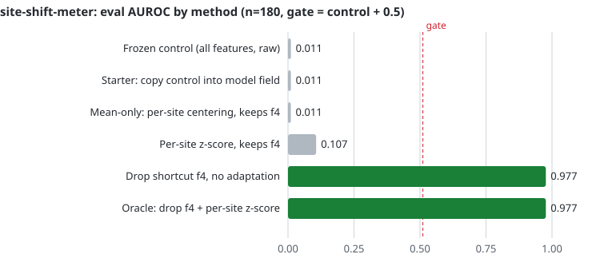

# agent-eval-suite

Reference tasks and a technical report on catching no-op "wins" in agent evaluation.

[](https://doi.org/10.5281/zenodo.23829461)
[](LICENSE)

Outcome tests can certify a method that does nothing. A run looks green because the method is a no-op, the control was never recomputed, or the fixture was edited. This repo defines a pass-bar for task authorship and a construction for ranking metrics that makes fake deltas fail: AUROC is invariant to a constant score offset, so mean-only "adaptation" can't move it. Plant a train-site label shortcut that flips at eval, freeze a control that the verifier recomputes from data, and gate on the delta.

Report: [When the delta is fake](docs/tech-report.md) ([HTML](docs/tech-report.html), [PDF](docs/tech-report.pdf)). Cite: [10.5281/zenodo.23829461](https://doi.org/10.5281/zenodo.23829461), [`CITATION.cff`](CITATION.cff).

## Quick start

```bash
git clone https://github.com/gyanu2507/agent-eval-suite && cd agent-eval-suite
./scripts/reproduce.sh
```

Needs Python 3.10+ and `pytest`. Everything else is stdlib, no GPU. It runs the 25 task tests, the `site-shift-meter` oracle, the ablation, and the red team below. About 16 seconds on a laptop.

## Result: site-shift-meter



| Method | Eval AUROC | Delta vs control | v1.0 gate (0.08) | v1.1 gate (0.5) |
| --- | --- | --- | --- | --- |
| Frozen control (all features, raw) | 0.0108 | 0 | fail | fail |
| Starter: copies control into model field | 0.0108 | 0 | fail | fail |
| Mean-only: per-site centering, keeps shortcut `f4` | 0.0107 | -0.0001 | fail | fail |
| Per-site z-score, keeps `f4` | 0.1068 | +0.0959 | pass | fail |
| Drop `f4`, no adaptation | 0.9766 | +0.9658 | pass | pass |
| Oracle: drop `f4` + per-site z-score | 0.9766 | +0.9658 | pass | pass |

n_eval = 180. Eval is site S2, and training uses sites S0 and S1 with 220 rows each. Numbers come from [`scripts/site_shift_ablation.py`](scripts/site_shift_ablation.py), which writes [`docs/figures/site-shift-ablation.json`](docs/figures/site-shift-ablation.json).

Pure mean-centering is a no-op under AUROC, as the invariance argument predicts. The control collapses to 0.011 because it latches onto `f4`, whose label association flips at eval. All of the oracle's gain comes from dropping `f4`, and per-site variance scaling adds nothing on this data. Z-scoring without dropping `f4` moved AUROC to 0.107, which was enough to clear the v1.0 gate. v1.1 gates at 0.5, halfway between that and the shortcut-free methods. The reasoning is in [the task's CALIBRATION.md](tasks/site-shift-meter/CALIBRATION.md).

## Red team

Every task now has a grader, `tasks/<task>/tests/grade.py`, that scores any submission rather than only the reference. [`redteam/`](redteam) holds 21 attacks and 4 alternate correct solutions. Each attack is a plausible wrong answer or a cheat. Most are the reference with a single bug added, so a result traces back to one cause.

```bash
python3 redteam/run.py
```

The runner grades every candidate twice, under the v1.0 rules the tasks shipped with and under the current v1.1 rules. It works on a temp copy of `tasks/`, so an attack that edits fixtures can't touch the repo.

| Task | Attacks | Pass v1.0 | Pass v1.1 | What got through v1.0 |
| --- | --- | --- | --- | --- |
| site-shift-meter | 5 | 3 | 1 | a typed-in `model_auroc`, z-scoring that keeps `f4`, scoring with the eval labels |
| clearing-hold-ledger | 7 | 3 | 0 | a lookup table of the public test answers, a RELEASE that frees a hold twice, a HOLD that overwrites an open hold |
| slot-ring-buffer | 3 | 2 | 0 | counting empty reads, rejecting a seq that wrapped |
| incident-tool-desk | 6 | 4 | 0 | submitting before payments was healthy, evidence ids typed in without reading logs, a `resolution.json` that disagrees with the audit, a fake submit through the desk's private `_record` method |

All 4 alternate solutions pass both versions. Full per-candidate output, including which checks failed, is in [`docs/figures/redteam-results.json`](docs/figures/redteam-results.json). The fixes are listed in [CHANGELOG.md](CHANGELOG.md).

One hole is still open. `site-shift-meter` ships its eval labels in the agent-visible `eval.csv`, so scoring with the labels gets AUROC 1.0 and passes. Closing it means moving the labels behind the verifier, which changes the task's interface. The tech report describes the v1.0 tasks.

## Reference tasks

| Task | What it shows about the pass-bar |
| --- | --- |
| [`site-shift-meter`](tasks/site-shift-meter) | Primary construction: fake delta vs shortcut flip + frozen control |
| [`clearing-hold-ledger`](tasks/clearing-hold-ledger) | Artifact-backed replay. Fixture edits and loose dedupe fail |
| [`slot-ring-buffer`](tasks/slot-ring-buffer) | A contract that single-consumer greens don't imply |
| [`incident-tool-desk`](tasks/incident-tool-desk) | Long-horizon tools and a clock, audit replay, text-judge false green |

Each task has a named starter failure, an oracle, tests, and a `CALIBRATION.md`. Trace rubric: [docs/trace-review.md](docs/trace-review.md). Judge vs verifier: [docs/judge-vs-verifier.md](docs/judge-vs-verifier.md).

## Pass-bar

| Criterion | Meaning |
| --- | --- |
| Nop failure | Starter fails for a failure mode you can state in one sentence |
| Oracle success | Reference solution clears every test |
| Artifact-backed score | Verifier recomputes the control or expected state. Report fields aren't trusted |
| Calibration record | Starter modes and blocked shortcuts are written down |

## Post-training on incident-tool-desk

LoRA SFT and DPO runs on Kaggle T4s, scored by the task's verifier rather than a text judge. Step-level SFT (train only on assistant tool calls, observations come back as user turns) passes the train ticket, a shifted ticket, and an unseen ticket. Full-transcript SFT invents observations and fails out of distribution. Details, kernels and the full table: [experiments/sft/RESULTS.md](experiments/sft/RESULTS.md). Adapters are under `experiments/sft/runs/` (about 28MB in total).

## Author

Gyanu Mayank, independent researcher. B.Tech CSE, NIT Patna.

Related upstream work on eval integrity: [Harbor #4003](https://github.com/harbor-framework/harbor/pull/4003), [Terminal-Bench #2480](https://github.com/harbor-framework/terminal-bench/pull/2480).
